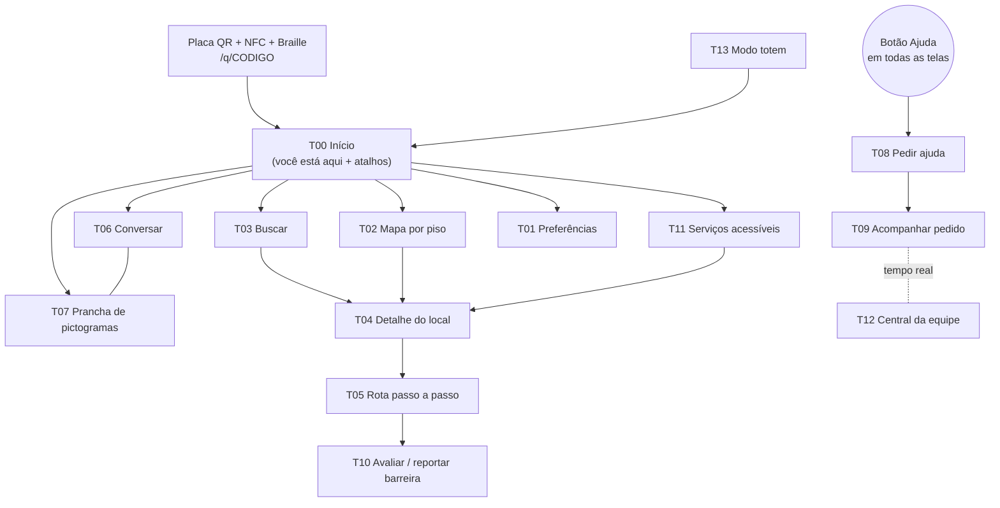

# 4. Proposta e estrutura inicial das telas

> Atende ao item **“Proposta e estrutura inicial das telas”** da 1ª entrega. Os esboços de baixa fidelidade estão no **Apêndice A** e, em versão navegável, em [`wireframes/index.html`](../wireframes/index.html).

## 4.1 Princípios de UX inclusiva (valem para todas as telas)

1. **Uma ação principal por tela**, com título (`h1`) único e descritivo, que o leitor de tela anuncia na navegação.
2. **No máximo 3 interações** para qualquer tarefa crítica: encontrar um local, pedir ajuda, mudar idioma, ativar voz.
3. **Redundância multimodal:** tudo o que é falado também é escrito, e vice-versa. Ícone sempre acompanhado de texto. Nunca informar só por cor.
4. **Alvos de toque ≥ 48 × 48 px** com espaçamento ≥ 8 px (acima do mínimo de 24 px da WCAG 2.2 AA).
5. **Linguagem simples** em pt-BR: frases curtas, voz ativa, sem jargão (“Pedir ajuda”, e não “Abrir chamado”).
6. **Ajuda sempre no mesmo lugar** (WCAG 3.2.6): botão “Ajuda” fixo no rodapé, em todas as telas.
7. **Sem limite de tempo** para o visitante. No totem, aviso antes do reinício, com opção de continuar.
8. **Movimento mínimo:** respeita “reduzir movimento” do sistema; nada pisca.
9. **Sem gestos complexos obrigatórios:** o mapa tem botões de zoom e deslocamento, além da pinça (WCAG 2.5.7).
10. **Funciona em retrato e paisagem**, com zoom de 200% e reflow a 320 px de largura sem rolagem horizontal.
11. **Erros dizem como corrigir** e são anunciados (`aria-live`).
12. **Preferências aplicadas antes da primeira pintura** (sem “piscar” o tema), via script inline (ver Cap. 9).

## 4.2 Mapa de navegação

## 4.3 Inventário de telas

| ID | Tela | Rota (App Router) | Objetivo | MVP |
|---|---|---|---|---|
| T00 | Início | `/[locale]` | Mostrar **onde a pessoa está** (pelo QR) e os 6 atalhos principais | Must |
| T01 | Preferências | `/[locale]/preferencias` | Configurar como a pessoa quer receber informação. **Opcional e pulável** | Must |
| T02 | Mapa por piso | `/[locale]/mapa/[piso]` | Ver a planta com camadas; alternativa **em lista** | Must |
| T03 | Buscar | `/[locale]/buscar` | Achar lojas, serviços e sanitários por nome, categoria, sinônimo ou voz | Must |
| T04 | Detalhe do local | `/[locale]/locais/[slug]` | Informações do local em texto, voz, linguagem simples e Libras | Must |
| T05 | Rota | `/[locale]/rota?de=&para=` | Rota acessível por perfil, passo a passo, com status de elevadores | Must |
| T06 | Conversar | `/[locale]/conversar` | Conversa frente a frente: legenda, digitar e falar, tradução, frases prontas, intérprete | Must |
| T07 | Prancha | `/[locale]/prancha` | Comunicação por pictogramas (CAA), com fala e tradução | Must |
| T08 | Pedir ajuda | `/[locale]/ajuda` | Pedido com tipo, local e modo de comunicação; números de emergência | Must |
| T09 | Acompanhar pedido | `/[locale]/ajuda/[id]` | Status do pedido em tempo real (anunciado) | Must |
| T10 | Avaliar / reportar | `/[locale]/avaliar` | Avaliar a rota e reportar barreira física ou digital | Should |
| T11 | Serviços acessíveis | `/[locale]/servicos` | Sanitários PNE, fraldário, empréstimo de cadeira de rodas, área tranquila, mesas reservadas, horários | Should |
| T12 | Central da equipe | `/central` (equipe, pt-BR) | Fila de pedidos em tempo real, status de equipamentos, barreiras | Must |
| T13 | Modo totem | `/totem/[ponto]` | Versão quiosque: alcance para cadeira de rodas, áudio por fone, reinício automático | Could |
| — | Declaração de acessibilidade | `/[locale]/acessibilidade` | Nível de conformidade, limitações conhecidas, canal de contato | Must |
| — | Privacidade | `/[locale]/privacidade` | Aviso LGPD em linguagem simples | Must |
| — | Resolvedor de QR/NFC | `/q/[codigo]` (Route Handler) | Converte o código do ponto em contexto de localização e redireciona | Must |

## 4.4 Componentes transversais (presentes em todas as telas do visitante)

| Componente | Descrição | Acessibilidade |
|---|---|---|
| **Cabeçalho** | Voltar · título da tela · idioma (PT/EN/ES) · **Libras** (ativa o VLibras) · **Ouvir** (lê a tela) | Landmark `header`; botões com nome acessível; ordem de foco fixa |
| **Botão “Ajuda”** | Fixo no rodapé (zona do polegar); abre T08 | Mesmo lugar em todas as telas (WCAG 3.2.6); 2 etapas para evitar acionamento acidental |
| **Anunciador** | Região `aria-live` única (polite/assertive) usada por todo o app | Evita anúncios duplicados; mensagens curtas |
| **Indicador de conexão** | “Sem internet: mapa, rotas e prancha continuam funcionando” | Texto + ícone; anunciado uma vez (`useOffline`) |
| **Atalhos de leitura** | Aa− / Aa+ / contraste | Afetam tokens CSS globais |
| **Link “Pular para o conteúdo”** | Primeiro elemento focável | WCAG 2.4.1 |
| **Rodapé** | Acessibilidade · Privacidade · versão dos dados | — |

## 4.5 Detalhamento das telas

### T00: Início
- **Estrutura (de cima para baixo):** cabeçalho → cartão **“Você está em: Entrada Av. JK · 1º pavimento”**, com botão “Não é aqui? Escolher onde estou” → **6 atalhos grandes**: *Buscar*, *Mapa*, *Conversar*, *Prancha*, *Serviços acessíveis*, *Preferências* → aviso do dia (ex.: “Hora silenciosa sábado, 9h–10h”) → botão Ajuda.
- **Entrada:** via `/q/[codigo]` (contexto pré-carregado) ou acesso direto (pede “Onde estou?” com lista de pontos de referência).
- **Acessibilidade:** anuncia o local ao abrir (se “voz” estiver ativa); atalhos em grade com rótulos textuais.
- **Diferença da v1:** o app **não pede para escanear de novo** (a pessoa já escaneou para chegar). O scanner interno serve só para trocar de ponto. A antiga T04 “Menu” foi fundida aqui (menos telas, menos toques).

### T01: Preferências
- **Pergunta-guia:** “O que facilita para você?” (e não “Qual sua deficiência?”).
- **Blocos:** *Ver* (letra grande, alto contraste, tema escuro) · *Ouvir* (ler telas em voz alta, velocidade da voz) · *Entender* (linguagem simples, pictogramas) · *Comunicar* (Libras, texto, idioma) · *Locomover* (evitar escadas, evitar escadas rolantes, preferir elevador, evitar áreas ruidosas) · *Sentir* (vibração).
- **Prévia ao vivo**; botão **“Pular”** sempre visível; atalho “Restaurar padrão”.
- **Privacidade:** “Suas preferências ficam só neste celular” (localStorage). Nenhum dado vai para o servidor.

### T02: Mapa por piso
- **Seletor de piso** fixo: *1º pavimento – Térreo* · *2º pavimento – Praça de Alimentação* (subsolos na fase 2).
- **Mapa SVG** vetorizado da Planta Mix com botões **+ / − / centralizar / “onde estou”**; toque num local abre T04.
- **Camadas:** Lojas · Alimentação · Sanitários (PNE, família) · Elevadores e escadas rolantes (com status) · **Mesas reservadas PcD** · **Sensorial** (áreas ruidosas e tranquilas) · Ajuda (SAC, brigada).
- **Alternativa textual obrigatória:** botão “Ver como lista”, com locais agrupados por setor e distância.
- **Acessibilidade:** o SVG tem `role="img"` e título; os marcadores são botões focáveis; a lista é equivalente completo do mapa.

### T03: Buscar
- Campo com **busca por voz**, tolerante a acentos e erros (“ca” → C&A; “banheiro” → sanitário; “lanche” → alimentação).
- **Categorias** em chips: Alimentação, Moda, Serviços, Lazer, Sanitários, Acessibilidade.
- Resultados com **distância a partir do ponto atual**, piso e ícone; 1 toque leva à T04 ou direto à rota.
- Estado vazio útil: “Não achei ‘xyz’. Quer pedir ajuda a um atendente?”

### T04: Detalhe do local
- **Cabeçalho do local:** nome, número da loja (ex.: “Outback Steakhouse · Loja 32 · 1º pavimento”), categoria, horário, **status aberto/fechado**.
- **Ações:** **Como chegar** (primária) · Ouvir · Ver em Libras · Linguagem simples · Traduzir.
- **Acessibilidade do local** (quando informado): balcão rebaixado, cardápio em Braille/QR, atendimento em Libras, nível de ruído.
- **Cardápio** (restaurantes): conteúdo **fornecido pela loja**. No protótipo, itens marcados como **ilustrativos**.

### T05: Rota passo a passo
- **Resumo:** origem → destino, distância, tempo estimado e **perfil aplicado** (“sem degraus”).
- **Passos numerados** no padrão Wayfindr: ação + distância + referência (“Siga em frente 40 m pela Alameda das Cores. A Camicado fica à sua esquerda.”).
- **Mudança de piso** sempre por **elevador** quando o perfil exige; se o elevador estiver fora de serviço, a rota é recalculada e o motivo é informado.
- **Modo áudio** (lê passo a passo, com botões “Repetir”, “Próximo” e “Anterior”); **vibração** antes de cada curva; tela não apaga (Wake Lock) durante a rota.
- **Mini-mapa opcional** (pode ser ocultado); a lista de passos é a interface principal.
- Botões: “Cheguei” (→ T10) · “Estou perdido” (→ T08 com local do último passo).

### T06: Conversar
- **Tela dividida frente a frente:** a metade de cima, **girada 180°**, é a do atendente; a de baixo é do visitante. Cada lado tem seu idioma (PT, EN, ES) e modo (**falar**, **digitar**, **frases prontas**).
- **Legenda ao vivo** (reconhecimento de fala) em letras grandes; **“digite e o celular fala”** (síntese de voz); tradução automática entre os lados.
- **Libras:** avatar VLibras para o texto do atendente + botão **“Chamar intérprete de Libras”** (videochamada; parceria).
- **Frases prontas offline** (exemplos): “Quanto custa?”, “Tem outro tamanho?”, “Posso pagar com cartão?”, “Onde fica o caixa?”, “Pode escrever, por favor?”, “Sou surdo(a)”.
- **Privacidade:** nada é gravado; o histórico some ao sair. Aviso de que o reconhecimento de fala do navegador pode usar servidores do fabricante.

### T07: Prancha de comunicação (CAA)
- **Grades de pictogramas** por tema: *Necessidades* (banheiro, água, ajuda, dor, cansado), *Sentimentos* (barulho demais, com medo, quero sair), *Compras* (quanto custa, outro tamanho, pagar), *Lugares* (praça de alimentação, saída, estacionamento).
- Tocar num pictograma **fala a frase**, mostra o texto em **destaque para o atendente** e traduz se o idioma for diferente.
- **Montar frase** (2–3 pictogramas) e **“Mostrar em tela cheia”** para o atendente.
- Pictogramas **Mulberry Symbols** (licença CC BY-SA, uso comercial permitido com atribuição).

### T08: Pedir ajuda
- **Etapa 1:** “Que tipo de ajuda?” *Orientação* · *Acompanhamento até um local* · *Comunicação (Libras/idioma)* · *Mal-estar/saúde* · *Criança perdida* · *Segurança*.
- **Etapa 2: confirmação**, mostrando local detectado (“Mesa 07, Praça de Alimentação”), editável, e **como prefere se comunicar** (texto, Libras, voz, idioma, pictogramas), com consentimento explícito para enviar essa informação.
- **Sempre visível:** **SAMU 192 · Bombeiros 193 · Polícia 190** (links `tel:`), para emergências reais.
- Sem CAPTCHA (barreira de acessibilidade); proteção por limite de envios e confirmação.

### T09: Acompanhar pedido
- Linha do tempo: **Enviado → Aceito por Luana → A caminho (≈ 3 min) → Concluído**, com anúncio `aria-live` e vibração a cada mudança.
- Ações: **Cancelar** · **Atualizar meu local** · **Abrir conversa** (T06) para quando a atendente chegar.
- **Sem internet:** instrução para ir ao SAC mais próximo, com rota offline.

### T10: Avaliar / reportar barreira
- “Chegou bem?” com 5 estrelas **ou** respostas por voz/botões grandes (“Sim”, “Com dificuldade”, “Não”).
- **Reportar barreira:** *Elevador parado*, *Escada sem alternativa*, *Caminho bloqueado*, *Sinalização ruim*, *Problema no app*, *Outro*. Local preenchido automaticamente; foto opcional (aviso para não fotografar pessoas).
- Formulário que funciona **sem JavaScript** (Server Action) e com erros anunciados.

### T11: Serviços acessíveis
- Lista com rota em 1 toque: sanitários PNE e família, fraldário, SAC, empréstimo de cadeira de rodas (se houver), **mesas reservadas PcD na praça de alimentação**, área tranquila / sala sensorial (se houver), vagas especiais nos subsolos, horários do shopping, eventos inclusivos (hora silenciosa).
- Conteúdo mantido pela equipe do shopping (fase 2: CMS).

### T12: Central da equipe (uso interno)
- **Fila em tempo real** (som + destaque visual): tipo, local, piso, **modo de comunicação**, idioma, tempo de espera; prioridade automática para *saúde* e *criança perdida*.
- Ações: **Aceitar**, informar previsão, **a caminho**, **concluir**, marcar **trote**.
- **Equipamentos:** alternar status de elevadores e escadas rolantes (*operando*, *manutenção*, *fora de serviço*). Atualiza as rotas dos visitantes.
- **Barreiras reportadas:** triagem e resolução; **indicadores** do dia.
- Acesso com login da equipe (Supabase Auth); a interface segue as mesmas regras de acessibilidade (a equipe também pode ter deficiência).

### T13: Modo totem
- Mesma aplicação em **modo quiosque** (Chrome em tela cheia): layout com elementos interativos na **faixa de alcance de cadeira de rodas** (ABNT NBR 9050), áudio por **fone de ouvido**, teclado na tela, **reinício automático** após inatividade (com aviso e opção de continuar) e **limpeza de dados** entre usuários.
- Permite **tradução on-device** (Translator API do Chrome desktop), pois o totem roda Chrome desktop.

## 4.6 Estados globais de cada tela

| Estado | Comportamento padrão |
|---|---|
| Carregando | Esqueleto com texto “Carregando…” anunciado uma única vez; nunca só *spinner* |
| Sem internet | Funções offline continuam (mapa, rota, busca, prancha, frases); funções online explicam a limitação e oferecem alternativa |
| Erro | Mensagem em linguagem simples + ação (“Tentar de novo”, “Pedir ajuda”) |
| Sem permissão (câmera/microfone) | Explica para que serve e oferece alternativa (digitar código curto, digitar texto) |
| Recurso não suportado (ex.: reconhecimento de fala no Firefox) | Esconde o botão e oferece alternativa equivalente |

## 4.7 Mudanças em relação às telas da v1

| v1 | v2 | Motivo |
|---|---|---|
| T00 Landing + T04 Menu | **T00 Início** | Menos uma tela e menos um toque; o QR já informa o local |
| T01 Perfil “visual/auditivo/motório/cognitivo” | **T01 Preferências funcionais**, puláveis | Respeito, LGPD e melhor ajuste (necessidades se combinam) |
| T03 Lojas & cardápios | **T03 Buscar** + **T04 Detalhe** | Separar descoberta de detalhe; deep link para cada local |
| T05 Rota (perfil motor usando escada rolante) | **T05 Rota** com elevador obrigatório no perfil, status e recálculo | Correção de segurança |
| T06 Tradutor | **T06 Conversar** (frente a frente, offline, intérprete humano) | Libras → português por IA não é confiável; frases prontas funcionam sem internet |
| — | **T07 Prancha de pictogramas** | Autismo, afasia, surdez e estrangeiros (comunicação universal) |
| T07 Suporte/Pânico | **T08 Pedir ajuda + T09 Acompanhar** | “Pânico” confunde emergência com orientação; agora há números 192/193/190, confirmação e acompanhamento |
| T08 Feedback | **T10 Avaliar / reportar** | Mantida e ampliada |
| — | **T11 Serviços acessíveis**, **T12 Central**, **T13 Totem** | Operação real do shopping e acesso sem celular |
