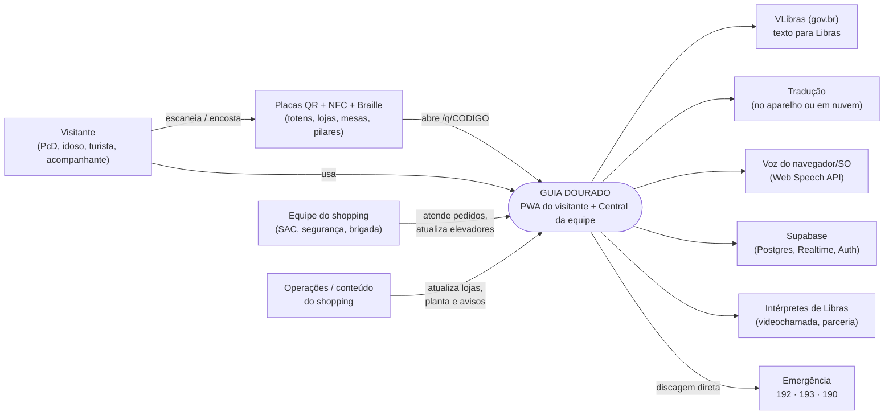
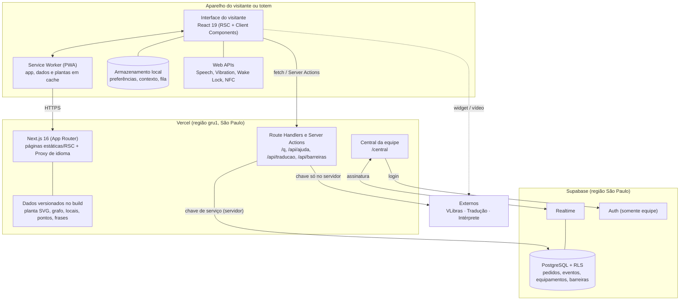
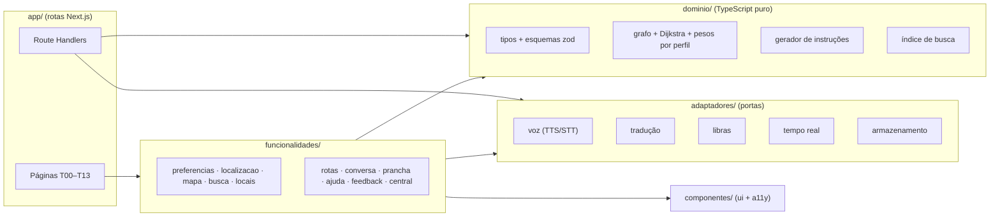
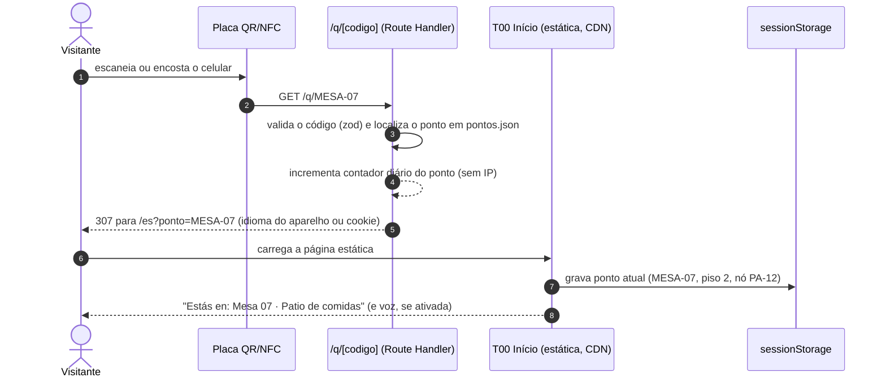
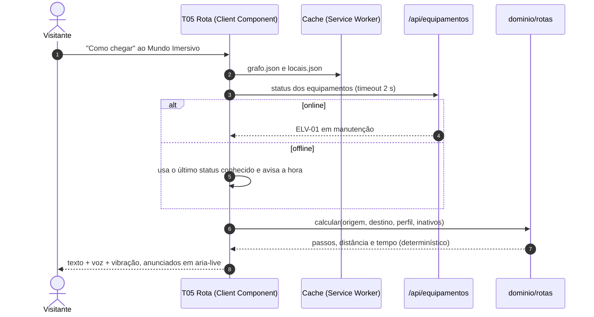
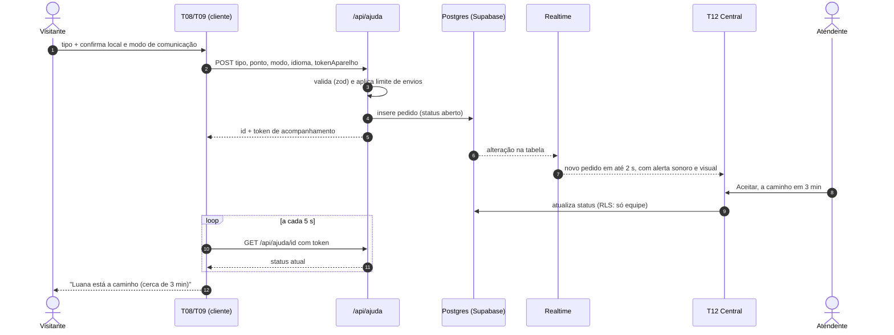
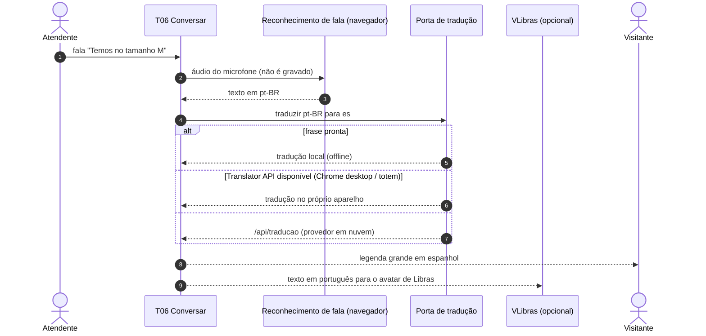
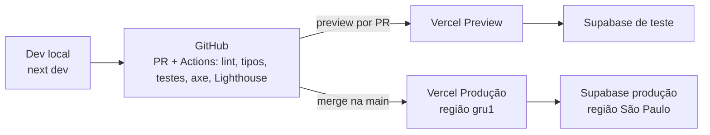

# 7. Arquitetura proposta

## 7.1 Princípios

1. **Offline-first nas funções críticas.** Mapa, busca, rotas, prancha e frases prontas funcionam sem internet.
2. **Domínio puro e determinístico.** Grafo, rotas, instruções e busca ficam em TypeScript sem I/O, rodam igual no cliente e no servidor e são 100% testáveis. **Nenhuma rota é gerada por IA.**
3. **Portas e adaptadores** (arquitetura hexagonal) para tudo que é externo: voz, tradução, Libras, tempo real e armazenamento. Trocar de fornecedor não mexe nas telas.
4. **Renderização no servidor por padrão** (React Server Components). Client Components só onde há interação. Menos JavaScript no celular.
5. **Privacidade por concepção.** Preferências (que podem revelar deficiência) **nunca saem do aparelho**. O servidor só recebe o mínimo, com consentimento.
6. **Monólito modular.** Um repositório e um deploy, organizados por **funcionalidades** com fronteiras claras. Simples para 24 h, pronto para crescer.
7. **Aprimoramento progressivo.** Formulários funcionam sem JavaScript (Server Actions); o mapa tem lista equivalente; a voz tem alternativa em texto.
8. **Dados como código.** Planta, grafo, locais e pontos são versionados no Git e validados por esquema no CI.

## 7.2 Contexto (C4, nível 1)



## 7.3 Contêineres (C4, nível 2)



| Contêiner | Responsabilidade | Tecnologia |
|---|---|---|
| Interface do visitante | Telas T00–T11 e T13, preferências, mapa, rotas, conversa, prancha | React 19, Next.js 16, Tailwind 4, shadcn/ui (Radix) |
| Service Worker | Cache do app e dos dados; funcionamento offline | Serwist (ou SW próprio) + `app/manifest.ts` |
| Next.js (servidor) | Páginas estáticas por idioma e local; Proxy de idioma; metadados | Next.js 16 App Router, next-intl 4 |
| Route Handlers / Server Actions | Resolver QR, criar e consultar pedidos, traduzir, receber barreiras | Node.js 22, zod |
| Dados versionados | Planta SVG, grafo, locais, pontos, equipamentos, frases, prancha | JSON validado por zod no CI |
| Central da equipe | Fila em tempo real, status de equipamentos, barreiras | React + Supabase Realtime + Auth |
| Banco | Pedidos, eventos, status, barreiras, avaliações, contadores | PostgreSQL (Supabase) com RLS |

## 7.4 Componentes (C4, nível 3) e organização do código



**Regras de dependência:** `dominio/` não importa nada de React, Next.js ou adaptadores. `funcionalidades/` usa `dominio/`, `adaptadores/` e `componentes/`. `app/` só compõe. Uma regra de lint (`no-restricted-imports`) garante isso.

```text
capim-dourado-acessivel/
├── dados/                         # dados versionados (validados no CI)
│   ├── pisos.json  locais.json  grafo.json  pontos.json
│   ├── equipamentos.json  frases-prontas.json  prancha.json
├── docs/                          # esta documentação + ADRs
├── public/
│   ├── plantas/                   # terreo.svg, praca-alimentacao.svg
│   ├── pictogramas/               # Mulberry Symbols (CC BY-SA)
│   └── libras/                    # vídeos curtos com intérpretes
├── src/
│   ├── app/
│   │   ├── [locale]/              # visitante (pt-BR, en, es)
│   │   │   ├── layout.tsx  page.tsx (T00)
│   │   │   ├── preferencias/  mapa/[piso]/  buscar/  locais/[slug]/
│   │   │   ├── rota/  conversar/  prancha/  ajuda/  ajuda/[id]/
│   │   │   ├── avaliar/  servicos/  acessibilidade/  privacidade/
│   │   ├── central/               # T12 (equipe)
│   │   ├── totem/[ponto]/         # T13 (ativa modo quiosque)
│   │   ├── q/[codigo]/route.ts    # resolvedor de QR/NFC
│   │   ├── api/                   # ajuda, traducao, equipamentos, barreiras
│   │   └── manifest.ts
│   ├── proxy.ts                   # negociação de idioma (Next.js 16)
│   ├── i18n/  mensagens/          # next-intl + pt-BR.json, en.json, es.json
│   ├── dominio/                   # tipos, esquemas, grafo, rotas, instruções, busca
│   ├── funcionalidades/           # uma pasta por funcionalidade
│   ├── adaptadores/               # voz, traducao, libras, tempo-real, armazenamento
│   ├── componentes/               # ui (shadcn), a11y, layout
│   └── lib/                       # env, supabase, utilidades
├── supabase/migrations/           # SQL versionado
├── ferramentas/                   # scripts: validar dados, gerar QR, extrair planta
├── tests/e2e/                     # Playwright + axe
└── wireframes/index.html
```

## 7.5 Fluxos principais

### 7.5.1 Chegada pelo QR/NFC



### 7.5.2 Rota acessível (funciona offline)



### 7.5.3 Pedido de ajuda em tempo real



### 7.5.4 Conversa com tradução



## 7.6 Estratégia offline

| Recurso | Estratégia de cache | Observação |
|---|---|---|
| Casca do app (HTML, JS, CSS, fontes) | Pré-cache na instalação do Service Worker | Versionado por build |
| Plantas SVG, grafo, locais, pontos, frases, pictogramas | Pré-cache | Pequenos (meta < 1,5 MB no total) |
| Páginas de locais (T04) | *Stale-while-revalidate* + *prefetch* do Next.js | Ficam disponíveis depois da 1ª visita |
| Status de equipamentos | Rede primeiro (timeout 2 s) → último valor conhecido | Mostra “atualizado há X min” |
| Pedido de ajuda | Exige conexão; offline mostra **rota até o SAC** e orientação | Sem promessas falsas |
| VLibras e tradução em nuvem | Só online | Frases prontas e prancha cobrem o offline |
| Navegações e Server Actions | `experimental.useOffline` do Next.js 16.4 mantém a requisição pendente e repete quando a rede volta | Hook `useOffline()` mostra o aviso ao usuário |

## 7.7 Estado no cliente

| Estado | Onde fica | Duração | Vai para o servidor? |
|---|---|---|---|
| Preferências (voz, contraste, perfil de rota…) | `localStorage` (`gd:preferencias:v1`) | Até o usuário limpar | **Nunca** |
| Ponto atual (contexto do QR) | `sessionStorage` (`gd:ponto`) | Sessão | Só ao pedir ajuda (com consentimento) |
| Sessão de rota | Estado React + `sessionStorage` | Sessão | Não |
| Idioma | Cookie `NEXT_LOCALE` (next-intl) | 1 ano | Sim (não é sensível) |
| Token do aparelho (limite de pedidos) | `localStorage` (UUID aleatório) | Até limpar | Sim (pseudônimo) |
| Pedido ativo | `sessionStorage` (id + token) | Até concluir | Sim |

## 7.8 Segurança em camadas (detalhes no Cap. 11)

| Camada | Controles |
|---|---|
| Borda | HTTPS/HSTS, CSP com lista de origens (VLibras, Supabase), cabeçalhos de segurança, limite de requisições |
| Aplicação | zod em todas as entradas; Server Actions com verificação de origem; segredos só em variáveis de servidor |
| Dados | RLS no Postgres: visitante não lê a tabela; equipe autenticada; chave de serviço só no servidor |
| Abuso | Confirmação em 2 etapas, limite por aparelho/IP, marcação de “trote”, sem CAPTCHA (barreira de acessibilidade) |
| Físico | Placas com código curto e domínio visíveis, lacre anti-adulteração, inspeção periódica contra **QR falso colado por cima** |

## 7.9 Implantação e ambientes



| Ambiente | Uso | Dados |
|---|---|---|
| Local | Desenvolvimento | Supabase local (CLI) ou projeto de teste; adaptadores *mock* de voz e tradução |
| Preview | Cada PR com URL própria; testes E2E e Lighthouse | Projeto Supabase de teste |
| Produção | Piloto no shopping | Projeto Supabase de produção (região São Paulo) |

## 7.10 Cenários de atributos de qualidade

| Atributo | Cenário | Resposta da arquitetura |
|---|---|---|
| Disponibilidade | Wi-Fi cai na praça de alimentação no meio da rota | Service Worker + roteamento no cliente: a rota continua |
| Segurança física | Elevador quebra | Status na Central → sai do grafo → rotas recalculadas |
| Desempenho | QR escaneado em 4G fraco | Página estática na CDN em São Paulo, pouco JS (RSC) → LCP ≤ 2,5 s |
| Privacidade | Visitante ativa “evitar escadas” | Preferência fica só no aparelho; o servidor nunca recebe |
| Modificabilidade | Loja muda de lugar | Editar `dados/locais.json` (fase 2: CMS) → validação no CI → deploy, sem mexer em código |
| Interoperabilidade | Shopping troca de provedor de tradução | Novo adaptador implementa a porta; telas intactas |
| Usabilidade | Pessoa sem celular ou sem familiaridade | Modo totem + ajuda humana + linguagem simples |
| Abuso | Trote no botão de ajuda | 2 etapas, limite por aparelho/IP, marcação de trote |

## 7.11 Evolução prevista

| Fase | Arquitetura |
|---|---|
| **MVP (14/11)** | Monólito Next.js + dados em JSON + Supabase para pedidos e status |
| **Piloto (30–90 dias)** | CMS leve para lojas, cardápios e avisos (tabelas no Supabase + telas na Central); vídeos em Libras; placas NFC/Braille; integração com intérpretes; totens |
| **Escala** | Posicionamento contínuo (beacons no padrão Wayfindr ou câmera); NaviLens; exportação **IMDF** para mapas de terceiros; multi-shopping (multi-tenant) para outros empreendimentos da administradora |
