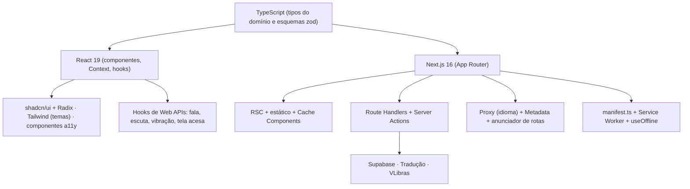

# 9. Como a tecnologia sorteada (React + Next.js) será incorporada

> Atende ao item **“Descrição de como a tecnologia ou prática sorteada será incorporada à solução”**. A tecnologia sorteada é **React + Next.js (TypeScript)**. Este capítulo mostra, recurso por recurso, **onde** cada um entra no Guia Dourado e **qual barreira de acessibilidade** ele ajuda a remover. Versões: **Next.js 16.4.6** e **React 19.3** (as mais recentes em 13/11/2026). Os trechos de código são **esboços de planejamento**.

## 9.1 Visão geral: recurso → uso → ganho de acessibilidade

| Recurso | Uso no Guia Dourado | Ganho para o visitante |
|---|---|---|
| **App Router + layouts aninhados** | Layout do visitante (`[locale]`) com cabeçalho, botão Ajuda e anunciador; layout próprio para a Central | Navegação **consistente** em todas as telas (WCAG 3.2.3 e 3.2.6) |
| **React Server Components (padrão)** | Fichas de loja, listas, textos e planta SVG renderizados no servidor | Menos JavaScript no celular → abre rápido no 4G (LCP ≤ 2,5 s) |
| **Geração estática** (`generateStaticParams`) | Uma página por **local** e por **piso**, em cada idioma, gerada no build | O QR abre uma página pronta na CDN de São Paulo |
| **Cache Components + Partial Prefetching** (padrão do Next 16.4) | Casca estática das páginas + partes dinâmicas (status de elevadores) em `<Suspense>` | A página aparece na hora; só o “ao vivo” espera a rede |
| **Route Handlers** (`route.ts`) | `/q/[codigo]` (resolver QR/NFC), `/api/ajuda`, `/api/traducao`, `/api/equipamentos` | Entrada por QR/NFC; chaves de API ficam **só no servidor** |
| **Server Actions + `<form action>`** | Avaliação, reporte de barreira e preferências da Central | **Formulários funcionam até sem JavaScript**; erros anunciados com `useActionState` |
| **Proxy** (`proxy.ts`, antigo middleware) | Negociação de idioma (pt-BR, en, es) via next-intl | O turista já abre o app no seu idioma |
| **Metadata API** | Título único e descritivo por tela (“Rota até Outback · Guia Dourado”) | O **anunciador de rotas** do Next lê o título a cada navegação |
| **Anunciador de rotas embutido** | Anuncia a nova página em navegações do lado do cliente | Usuário de leitor de tela sabe que a tela mudou |
| **`next/font`** | Atkinson Hyperlegible Next servida localmente, sem salto de layout | Leitura melhor para baixa visão; CLS ≈ 0 |
| **`next/image`** | Fotos de lojas e pratos com `alt` obrigatório e tamanhos responsivos | Imagem leve e com descrição |
| **`next/script`** | Carrega o **VLibras sob demanda** (só quando a pessoa ativa Libras) | Desempenho e privacidade |
| **`app/manifest.ts` + Service Worker** | PWA instalável (opcional) com cache de app e dados | **Offline** em mapa, rotas, prancha e frases |
| **`experimental.useOffline` + `useOffline()`** (`next/offline`) | Navegações e Server Actions esperam a rede voltar; aviso de “sem internet” | Nada “quebra” quando o Wi-Fi cai |
| **Loading, error e not-found** | `loading.tsx`, `error.tsx`, `not-found.tsx` com mensagens em linguagem simples | Estados claros e anunciados |
| **ESLint do Next com `jsx-a11y`** | Lint obrigatório no CI | Erros de ARIA, `alt` e rótulos detectados no editor |

## 9.2 Onde entra o React

| Recurso do React 19 | Uso |
|---|---|
| **Componentes reutilizáveis e acessíveis** | `BotaoAjuda`, `LerEmVoz`, `BotaoLibras`, `Anunciador`, `MapaDoPiso`, `ListaDeLocais`, `PassoDaRota`, `CartaoPictograma`, `TelaDividida`. Uma correção de acessibilidade num componente vale para o app inteiro |
| **Context** | `PreferenciasProvider` (tema, fonte, voz, perfil de rota), `LocalizacaoProvider` (ponto atual), `AnunciadorProvider` (região `aria-live` única) |
| **`useSyncExternalStore`** | Ler preferências do `localStorage` sem divergência entre servidor e cliente |
| **`useActionState`** | Formulários com erros anunciados e foco no primeiro campo inválido |
| **`useOptimistic`** | Pedido de ajuda aparece como “Enviando…” na hora, antes da confirmação |
| **`useTransition` / Suspense** | Busca e rota sem travar a interface; carregamento progressivo |
| **Hooks próprios para Web APIs** | `useFala` (SpeechSynthesis), `useEscuta` (SpeechRecognition), `useVibracao`, `useTelaAcesa` (Wake Lock), `useMovimentoReduzido`, `useConexao` |
| **Error Boundaries** | Uma falha no módulo de voz não derruba a rota |

## 9.3 Esboços de código

### 9.3.1 Preferências aplicadas antes da primeira pintura (sem “piscar” o tema)

O Next.js 16 recomenda um **script inline** que roda antes da pintura para estados que só o cliente conhece (guia *Preventing Flash*). É essencial para alto contraste e fonte grande.

```tsx
// src/app/[locale]/layout.tsx (trecho)
const scriptPreferencias = `
try {
  var p = JSON.parse(localStorage.getItem('gd:preferencias:v1') || '{}');
  var r = document.documentElement;
  if (p.tema) r.dataset.tema = p.tema;            // padrao | escuro | alto-contraste
  if (p.escalaFonte) r.style.setProperty('--escala-fonte', String(p.escalaFonte));
  if (p.reduzirMovimento) r.dataset.movimento = 'reduzido';
} catch (e) {}
`;

export default async function LayoutVisitante({ children, params }: LayoutProps<'/[locale]'>) {
  const { locale } = await params;
  return (
    <html lang={locale} suppressHydrationWarning>
      <head>
        <script dangerouslySetInnerHTML={{ __html: scriptPreferencias }} />
      </head>
      <body>
        <a href="#conteudo" className="pular-link">Pular para o conteúdo</a>
        <PreferenciasProvider>
          <AnunciadorProvider>
            <Cabecalho />
            <main id="conteudo" tabIndex={-1}>{children}</main>
            <BotaoAjuda />
          </AnunciadorProvider>
        </PreferenciasProvider>
      </body>
    </html>
  );
}
```

### 9.3.2 Página estática por local (Server Component)

```tsx
// src/app/[locale]/locais/[slug]/page.tsx (esboço)
import dados from '@dados/locais.json';

export function generateStaticParams() {
  return dados.locais.map((l) => ({ slug: l.slug }));   // × 3 idiomas no layout
}

export async function generateMetadata({ params }: PageProps<'/[locale]/locais/[slug]'>) {
  const { slug } = await params;
  const local = buscarLocal(slug);
  return { title: `${local.nome} · ${local.numero} · Guia Dourado` };
}

export default async function PaginaLocal({ params }: PageProps<'/[locale]/locais/[slug]'>) {
  const { slug, locale } = await params;
  const local = buscarLocal(slug);
  return (
    <article aria-labelledby="titulo-local">
      <h1 id="titulo-local">{local.nome}</h1>
      <p>{local.numero} · {nomeDoPiso(local.piso, locale)}</p>
      <AcoesDoLocal local={local} />          {/* Client Component: Ouvir, Libras, Como chegar */}
      <Suspense fallback={<p>Verificando horário…</p>}>
        <StatusAberto localId={local.id} />   {/* parte dinâmica */}
      </Suspense>
      <DescricaoAcessivel local={local} />    {/* texto + linguagem simples */}
    </article>
  );
}
```

### 9.3.3 Resolver o QR/NFC (Route Handler)

```ts
// src/app/q/[codigo]/route.ts (esboço)
import { NextResponse, type NextRequest } from 'next/server';
import { esquemaCodigo, buscarPonto } from '@/dominio/pontos';

export async function GET(req: NextRequest, ctx: RouteContext<'/q/[codigo]'>) {
  const { codigo } = await ctx.params;
  const valido = esquemaCodigo.safeParse(codigo.toUpperCase());
  const ponto = valido.success ? buscarPonto(valido.data) : undefined;
  const idioma = escolherIdioma(req);                 // cookie NEXT_LOCALE ou Accept-Language
  const destino = new URL(`/${idioma}`, req.url);
  if (ponto) destino.searchParams.set('ponto', ponto.codigo);
  else destino.searchParams.set('onde-estou', '1'); // RN-07
  registrarLeitura(ponto?.codigo ?? 'invalido');     // contador agregado, sem IP
  return NextResponse.redirect(destino, 307);
}
```

### 9.3.4 Reporte de barreira com Server Action (funciona sem JavaScript)

```tsx
// src/funcionalidades/feedback/acoes.ts
'use server';
export async function reportarBarreira(_: Estado, dados: FormData): Promise<Estado> {
  const r = esquemaBarreira.safeParse(Object.fromEntries(dados));
  if (!r.success) return { ok: false, erros: r.error.flatten().fieldErrors };
  await repositorioBarreiras.criar(r.data);
  return { ok: true, mensagem: 'Obrigado! A equipe vai verificar.' };
}

// src/funcionalidades/feedback/formulario-barreira.tsx
'use client';
export function FormularioBarreira() {
  const [estado, acao, enviando] = useActionState(reportarBarreira, { ok: false });
  return (
    <form action={acao} aria-describedby="status-barreira">
      {/* campos com <label>, erros ligados por aria-describedby */}
      <button disabled={enviando}>Enviar</button>
      <p id="status-barreira" role="status">{estado.mensagem}</p>
    </form>
  );
}
```

### 9.3.5 Idioma no Proxy (Next.js 16)

```ts
// src/proxy.ts
import createMiddleware from 'next-intl/middleware';
import { routing } from './i18n/routing';      // locales: ['pt-BR','en','es'], localePrefix: 'as-needed'

export default createMiddleware(routing);

export const config = {
  // não aplica o proxy em API, QR, Central, totem e arquivos estáticos
  matcher: ['/((?!api|q|central|totem|_next|_vercel|.*\\..*).*)'],
};
```

## 9.4 Mapa de dependências



## 9.5 Resumo para a banca

1. **React** organiza a acessibilidade em **componentes reutilizáveis**. Um único `BotaoAjuda` ou `LerEmVoz` correto garante o comportamento em todas as 14 telas.
2. **Next.js** entrega **velocidade** (páginas estáticas e RSC), **robustez** (formulários sem JavaScript, `useOffline`) e **organização** (rotas, Route Handlers, Proxy de idioma) num **único projeto**: app do visitante, API e Central.
3. Os recursos nativos do Next.js (anunciador de rotas, `jsx-a11y`, Metadata) **já trabalham a favor da acessibilidade**. O projeto os usa de forma deliberada.
