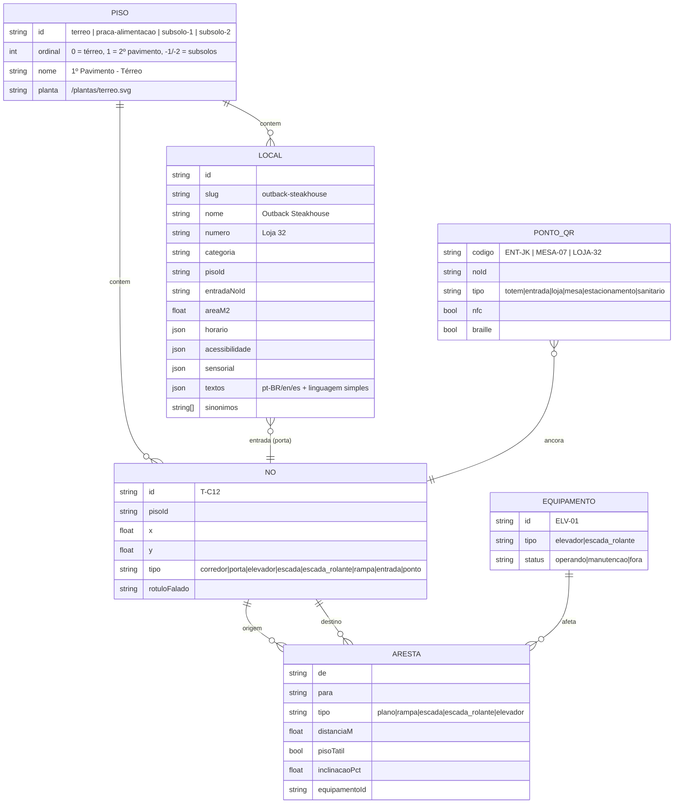

# 10. Modelo de dados, grafo e algoritmo de rotas

## 10.1 Modelo de dados (inspirado no IMDF)

O **IMDF** (*Indoor Mapping Data Format*, criado pela Apple e publicado pela OGC como *Community Standard* em 2021) descreve mapas internos em GeoJSON com entidades como *venue*, *level*, *unit*, *opening* e *amenity*. Adotamos um **subconjunto simplificado e compatível**, em JSON versionado, para poder exportar para IMDF no futuro.



**Exemplo real (conferido na Planta Mix):**

```json
{
  "id": "loc-outback",
  "slug": "outback-steakhouse",
  "nome": "Outback Steakhouse",
  "numero": "Loja 32",
  "categoria": "alimentacao",
  "pisoId": "terreo",
  "areaM2": 499.33,
  "entradaNoId": "T-P32",
  "sinonimos": ["outback", "steakhouse", "restaurante", "carne"],
  "acessibilidade": { "balcaoRebaixado": null, "cardapioBraille": null, "atendimentoLibras": null },
  "sensorial": { "ruido": "medio" },
  "textos": {
    "pt-BR": { "descricao": "…", "simples": "Restaurante. Fica no 1º piso, perto da Camicado." }
  },
  "fonte": "Planta Mix nov/2026 (folha 1/2)"
}
```

> `null` significa **não informado** (diferente de `false`). O app só afirma um recurso de acessibilidade quando ele foi **verificado**.

## 10.2 Do PDF ao grafo: método de construção

O grafo da v1 foi gerado a partir da **posição dos rótulos** no PDF, ligando cada rótulo aos 3 vizinhos mais próximos. Os testes mostraram **9 componentes desconexos**, **nenhum elevador** e ligações que atravessam paredes. Por isso, a v2 adota um processo **semiautomático com validação**:

1. **Vetorizar a planta** (folhas 1/2 e 2/2) em SVG simplificado: contorno, corredores e lojas como polígonos (camada visual do mapa).
2. **Extrair rótulos automaticamente** (script Python da v1, aproveitado e melhorado) para obter o **catálogo**: número da loja, área e marca.
3. **Desenhar o grafo de circulação** com o **Editor de Grafo** (ferramenta interna em `/central/editor`): nós nos **cruzamentos de corredores, portas, elevadores, escadas, rampas, entradas e pontos QR**, e arestas ao longo dos corredores, nunca atravessando lojas.
4. **Escala:** a planta está em 1:500. Calibração por uma medida conhecida (ex.: largura de um corredor cotado) converte unidades do SVG em metros.
5. **Ligar cada local à sua porta** (`entradaNoId`) e cada **equipamento** às arestas verticais.
6. **Validar automaticamente** no CI (10.3) e **validar em campo** (visita técnica com a equipe de operações).

## 10.3 Regras de validação (CI)

| Regra | Por quê |
|---|---|
| Todo `LOCAL` tem `entradaNoId` existente | Toda loja é alcançável |
| O grafo de cada piso é **conexo** | Sem “ilhas” como na v1 |
| Para o perfil **sem degraus**, todo local é alcançável a partir de todas as entradas | Garantia de acessibilidade (RN-01) |
| Todo elevador tem nós nos **dois pisos** e `equipamentoId` | Transição de piso válida |
| Arestas `rampa` com `inclinacaoPct` informada | Rampas acima de 8,33% são proibidas para cadeira de rodas (referência NBR 9050) |
| `distanciaM > 0` e coerente com as coordenadas (±20%) | Detecta erro de desenho |
| Todo `PONTO_QR` aponta para um nó existente; códigos únicos | QR nunca leva a lugar inválido |
| Textos obrigatórios nos 3 idiomas | i18n completa (RNF-07) |

## 10.4 Algoritmo de rotas

- **Algoritmo:** **Dijkstra** com fila de prioridade (*heap* binário), O((V + E) log V). Com menos de 1.000 nós, o cálculo leva poucos milissegundos no celular. A* com heurística euclidiana é uma otimização opcional.
- **Onde roda:** **no cliente** (offline). O mesmo módulo roda no servidor para testes e validação.
- **Custo de uma aresta:** `custo = distanciaM × fator(tipo, perfil) + penalidades`. Fator `∞` significa **proibido**.

| Tipo de aresta | padrão | sem_degraus (cadeira de rodas) | mobilidade_reduzida (idoso, muleta, carrinho) | visual | sensorial |
|---|---|---|---|---|---|
| plano | 1,0 | 1,0 | 1,0 | 1,0 (0,8 se `pisoTatil`) | 1,0 (×2 em zona ruidosa) |
| rampa ≤ 8,33% | 1,0 | 1,0 | 1,2 | 1,0 | 1,0 |
| rampa > 8,33% | 1,1 | **∞** | 2,0 | 1,1 | 1,1 |
| escada | 1,1 | **∞** | **∞** | 1,5 | 1,1 |
| escada rolante | 1,0 | **∞** | 3,0 (**∞** com carrinho de bebê) | 1,3 | 1,2 |
| elevador | +40 m equivalentes (espera) | +30 m | +20 m | +30 m | +60 m (espaço fechado) |
| equipamento inativo | **∞** | **∞** | **∞** | **∞** | **∞** |

> **Correção em relação à v1:** na v1, escada e escada rolante tinham peso finito (5 e 1) para todos, e o wireframe mostrava o perfil motor subindo por escada rolante. Na v2, essas arestas são **proibidas** para os perfis com restrição. O CI testa essa regra (RN-01).

```ts
// src/dominio/rotas/dijkstra.ts (esboço)
export function calcularRota(g: Grafo, origem: string, destino: string, opcoes: OpcoesRota): ResultadoRota {
  const dist = new Map<string, number>([[origem, 0]]);
  const anterior = new Map<string, Aresta>();
  const fila = new HeapMinimo<string>((a, b) => (dist.get(a) ?? Infinity) - (dist.get(b) ?? Infinity));
  fila.inserir(origem);
  while (!fila.vazia()) {
    const atual = fila.remover()!;
    if (atual === destino) break;
    for (const aresta of g.vizinhos(atual)) {
      const custo = custoAresta(aresta, opcoes);          // ∞ = proibida (perfil ou equipamento inativo)
      if (!Number.isFinite(custo)) continue;
      const novo = dist.get(atual)! + custo;
      if (novo < (dist.get(aresta.para) ?? Infinity)) {
        dist.set(aresta.para, novo);
        anterior.set(aresta.para, aresta);
        fila.inserirOuAtualizar(aresta.para);
      }
    }
  }
  if (!anterior.has(destino) && origem !== destino) return { ok: false, motivo: 'sem_caminho' };
  return montarResultado(reconstruir(anterior, origem, destino), opcoes);
}
```

## 10.5 Gerador de instruções (padrão Wayfindr / ITU-T F.921)

1. **Agrupar** arestas consecutivas quase retas (|Δângulo| < 30°) num único passo.
2. **Classificar a mudança de direção** pelo ângulo entre segmentos: < 30° “siga em frente”; 30°–150° “vire à esquerda/direita”; > 150° “retorne”.
3. **Anunciar com antecedência:** “Em 10 metros, vire à direita”.
4. **Usar marcos** (lojas âncora, praças, pisos táteis) em vez de pontos cardeais: “A Riachuelo fica à sua esquerda”.
5. **Distâncias** em metros arredondados (5 m) e, no perfil visual, também em passos aproximados.
6. **Mudança de piso:** “Pegue o **elevador ELV-01** até o **2º pavimento**. Ao sair, a Praça de Alimentação fica à frente.”
7. **Chegada:** “Você chegou. A entrada do Outback está à sua direita.”
8. **Modelos de frase** em pt-BR, en e es, com **linguagem simples** e sem abreviações.

Exemplo (perfil sem degraus, Entrada Av. JK → Mundo Imersivo):

| # | Instrução |
|---|---|
| 1 | Siga em frente por 35 metros pela Alameda das Cores. A Camicado fica à sua direita. |
| 2 | Vire à esquerda na Praça de Eventos. Siga 20 metros. |
| 3 | Pegue o elevador ELV-01 até o 2º pavimento, Praça de Alimentação. |
| 4 | Ao sair do elevador, siga 15 metros. Você chegou ao Mundo Imersivo (Loja 215), à sua frente. |

*(Distâncias ilustrativas até a calibração do grafo.)*

## 10.6 Busca

- **Normalização:** minúsculas, sem acentos e sem pontuação (“C&A” → “ca”, “Pernambucanas” → “pernambucanas”).
- **Sinônimos e categorias:** `banheiro → sanitário`, `lanche/comida → alimentação`, `cinema → Cinemark`, `academia → Morofit`, `mercado → Super Big`, `brinquedo → Ri Happy/Zig Zag Play`.
- **Tolerância a erro:** distância de edição ≤ 1 para termos curtos e ≤ 2 para longos.
- **Ordenação:** relevância textual → distância a partir do ponto atual → aberto agora.
- **Busca por número:** “loja 32”, “âncora 02”, “Q 15” (quiosque).

## 10.7 Pontos QR/NFC (códigos curtos)

| Tipo | Formato | Exemplos |
|---|---|---|
| Entrada / totem | `ENT-<via>` | `ENT-JK`, `ENT-NS`, `ENT-LO` |
| Loja | `LOJA-<número>` / `ANC-<número>` | `LOJA-32`, `ANC-02` |
| Mesa da praça de alimentação | `MESA-<nn>` | `MESA-07` |
| Estacionamento | `S<n>-P<pilar>` | `S1-P12` |
| Sanitário | `WC-<piso>-<n>` | `WC-2-1` |

URL gravada no QR e na etiqueta NFC: `https://<domínio>/q/<CÓDIGO>`. O **código curto também é impresso** (com Braille) para digitação manual em “Onde estou?”.

## 10.8 Banco de dados (Supabase / PostgreSQL)

```sql
-- supabase/migrations/0001_inicial.sql (esboço)
create type tipo_ajuda   as enum ('orientacao','acompanhamento','comunicacao','saude','crianca_perdida','seguranca');
create type modo_comunic as enum ('texto','libras','voz','idioma','pictogramas');
create type status_ajuda as enum ('aberto','aceito','a_caminho','concluido','cancelado','trote');

create table pedidos_ajuda (
  id                uuid primary key default gen_random_uuid(),
  criado_em         timestamptz not null default now(),
  tipo              tipo_ajuda not null,
  ponto_codigo      text not null,
  piso_id           text not null,
  modo_comunicacao  modo_comunic not null,
  idioma            text not null check (idioma in ('pt-BR','en','es')),
  observacao        text check (char_length(observacao) <= 280),
  status            status_ajuda not null default 'aberto',
  atendente_id      uuid references auth.users(id),
  previsao_min      int,
  token_hash        text not null,          -- hash do token de acompanhamento
  aparelho_hash     text not null,          -- hash do UUID do aparelho (limite de envios)
  consentimento_em  timestamptz not null    -- LGPD: consentimento para enviar o modo de comunicação
);

create table eventos_pedido (
  id bigserial primary key,
  pedido_id uuid references pedidos_ajuda(id) on delete cascade,
  criado_em timestamptz not null default now(),
  status status_ajuda not null,
  autor text not null                        -- 'visitante' | 'equipe'
);

create table equipamentos (
  id text primary key,                       -- ELV-01, ROL-01…
  tipo text not null check (tipo in ('elevador','escada_rolante')),
  status text not null default 'operando' check (status in ('operando','manutencao','fora')),
  atualizado_em timestamptz not null default now(),
  atualizado_por uuid references auth.users(id)
);

create table barreiras (
  id uuid primary key default gen_random_uuid(),
  criado_em timestamptz not null default now(),
  tipo text not null,
  ponto_codigo text,
  descricao text check (char_length(descricao) <= 500),
  status text not null default 'nova' check (status in ('nova','em_analise','resolvida','descartada'))
);

create table leituras_ponto_diarias (
  codigo text not null,
  dia date not null,
  total int not null default 0,
  primary key (codigo, dia)
);

alter table pedidos_ajuda enable row level security;
alter table equipamentos  enable row level security;
alter table barreiras     enable row level security;
-- políticas: somente usuários autenticados da equipe leem/atualizam;
-- o visitante nunca acessa as tabelas diretamente (só via Route Handlers no servidor).
```

## 10.9 Governança dos dados

| Dado | Dono | Atualização | Validação |
|---|---|---|---|
| Planta e grafo | Operações do shopping + equipe do projeto | A cada mudança física (obras, mudança de loja) | CI (10.3) + visita técnica |
| Catálogo de lojas e horários | Operações / marketing | Semanal ou quando houver mudança | Esquema zod + revisão |
| Cardápios | Cada loja | Pela loja (fase 2: portal do lojista) | Data da última atualização visível |
| Status de equipamentos | Manutenção / segurança | Em tempo real, na Central | Registro de quem alterou |
| Textos em linguagem simples, traduções, Libras | Conteúdo + intérpretes | A cada mudança de texto | Revisão humana obrigatória (RNF-15) |
