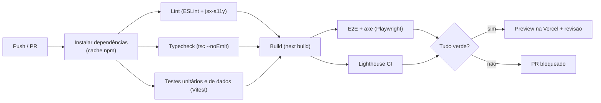

# 12. Qualidade e estratégia de testes

## 12.1 Pirâmide de testes

| Nível | Ferramenta | O que cobre | Meta |
|---|---|---|---|
| **Unitário (domínio)** | Vitest | Dijkstra, pesos por perfil, gerador de instruções, busca, validação dos dados | Cobertura ≥ 90% em `src/dominio` |
| **Componentes** | Vitest + Testing Library + jest-axe | Botões, formulários, anunciador, lista do mapa, prancha | 0 violações axe por componente |
| **Contrato de dados** | Vitest + zod | `dados/*.json` contra os esquemas + regras do 10.3 (conectividade, perfil sem degraus) | 100% no CI |
| **End-to-end** | Playwright + @axe-core/playwright | Jornadas J1–J6 em Chrome (Android emulado) e WebKit (iPhone emulado), nos 3 temas | Fluxos críticos verdes |
| **Desempenho e boas práticas** | Lighthouse CI | Desempenho ≥ 90, Acessibilidade = 100, PWA ok | Bloqueia PR abaixo da meta |
| **Manual com tecnologia assistiva** | TalkBack, VoiceOver, NVDA, teclado, zoom 200%/400% | O que a automação não pega (cerca de 60% dos problemas reais) | Checklist 12.4 a cada versão |
| **Usabilidade com pessoas com deficiência** | Testes moderados + SUS | Tarefas reais no shopping | SUS ≥ 80; sucesso ≥ 85% |

## 12.2 Casos de teste essenciais

| ID | Caso | Tipo |
|---|---|---|
| CT-01 | QR `ENT-JK` abre T00 com “Você está em: Entrada Av. JK” e título correto | E2E |
| CT-02 | Código inexistente abre “Onde estou?” sem erro (RN-07) | E2E |
| CT-03 | Perfil sem degraus: rota entre pisos **sempre** usa elevador; com ELV-01 inativo, usa outro ou informa “sem rota” + acompanhamento | Unitário + E2E |
| CT-04 | Instruções: curva de 90° gera “vire à direita”; trechos retos são agrupados | Unitário |
| CT-05 | Busca “ca” encontra C&A; “banheiro” encontra sanitários; “loja 32” encontra Outback | Unitário |
| CT-06 | Mapa em modo lista: todos os locais navegáveis por teclado, com nome e distância | E2E + axe |
| CT-07 | Alto contraste aplicado **antes da primeira pintura** (sem flash) após recarregar | E2E (screenshot) |
| CT-08 | Pedido de ajuda: criado → aparece na Central em ≤ 2 s → aceite reflete no visitante em ≤ 5 s | E2E (2 navegadores) |
| CT-09 | Limite: 2º pedido aberto no mesmo aparelho é recusado com mensagem clara (RN-03) | Integração |
| CT-10 | Formulário de barreira funciona **com JavaScript desativado** | E2E |
| CT-11 | Offline: com rede cortada, mapa, busca, rota e prancha funcionam; pedido de ajuda mostra rota até o SAC | E2E (modo offline) |
| CT-12 | Conversa: com reconhecimento de fala indisponível, botão “Falar” some e “Digitar” fica em destaque | Componente |
| CT-13 | `lang` correto em `/en` e `/es`; trechos traduzidos marcados com `lang` | E2E |
| CT-14 | Zoom de 200% e largura de 320 px: sem rolagem horizontal e sem texto cortado | E2E (viewport) |

## 12.3 Pipeline de CI (GitHub Actions)

## 12.4 Checklist manual de acessibilidade (a cada versão)

- [ ] Navegar por **todas as telas só com teclado** (Tab, Shift+Tab, Enter, Espaço, Esc); foco sempre visível e nunca escondido pelo botão Ajuda.
- [ ] **TalkBack** (Android/Chrome) e **VoiceOver** (iOS/Safari): títulos anunciados, botões com nome, ordem lógica, anúncios de rota e de pedido sem duplicar.
- [ ] **Zoom 200% e 400%**, fonte do sistema no máximo, largura de 320 px.
- [ ] **Alto contraste** e **tema escuro**: todos os textos e ícones legíveis; medir com o analisador de contraste.
- [ ] **Movimento reduzido** ativado no sistema: nenhuma animação relevante.
- [ ] Simulação de **daltonismo** (protanopia, deuteranopia, tritanopia): nenhuma informação só por cor.
- [ ] **Linguagem simples**: textos revisados (frases curtas, sem jargão).
- [ ] **Libras**: VLibras ativa e traduz a tela; vídeos com legenda.
- [ ] **Offline**: modo avião após a 1ª visita.

## 12.5 Testes com pessoas (coprojeto)

| Etapa | Quem | Como |
|---|---|---|
| Antes do piloto | ≥ 5 pessoas: cega, baixa visão, surda (Libras), cadeirante, autista/neurodivergente, idosa, turista | Teste moderado no shopping, com tarefas das jornadas J1–J5; intérprete de Libras presente |
| Parcerias sugeridas | Associação dos Surdos de Palmas (ASP) e Associação dos Deficientes Visuais do Estado do Tocantins, ambas no Conselho Municipal dos Direitos da Pessoa com Deficiência de Palmas | Convite via conselho; remuneração ou contrapartida aos participantes |
| Métricas | Sucesso da tarefa, tempo, erros, pedidos de ajuda, **SUS** | Relatório por jornada |
| Ética | Termo de consentimento acessível (Libras, áudio, texto simples) | Sem gravação de rosto sem autorização |

## 12.6 Definição de Pronto (DoD)

Uma história só está **pronta** quando:
1. Atende aos critérios de aceite (Cap. 5) e tem testes automatizados.
2. Passa no lint, typecheck, testes e **axe sem violações**.
3. Foi testada **com teclado** e com **um leitor de tela**.
4. Tem textos nos **3 idiomas** e versão em linguagem simples quando aplicável.
5. Funciona **offline**, se for uma funcionalidade crítica.
6. Foi revisada por outra pessoa da equipe (PR aprovado).
