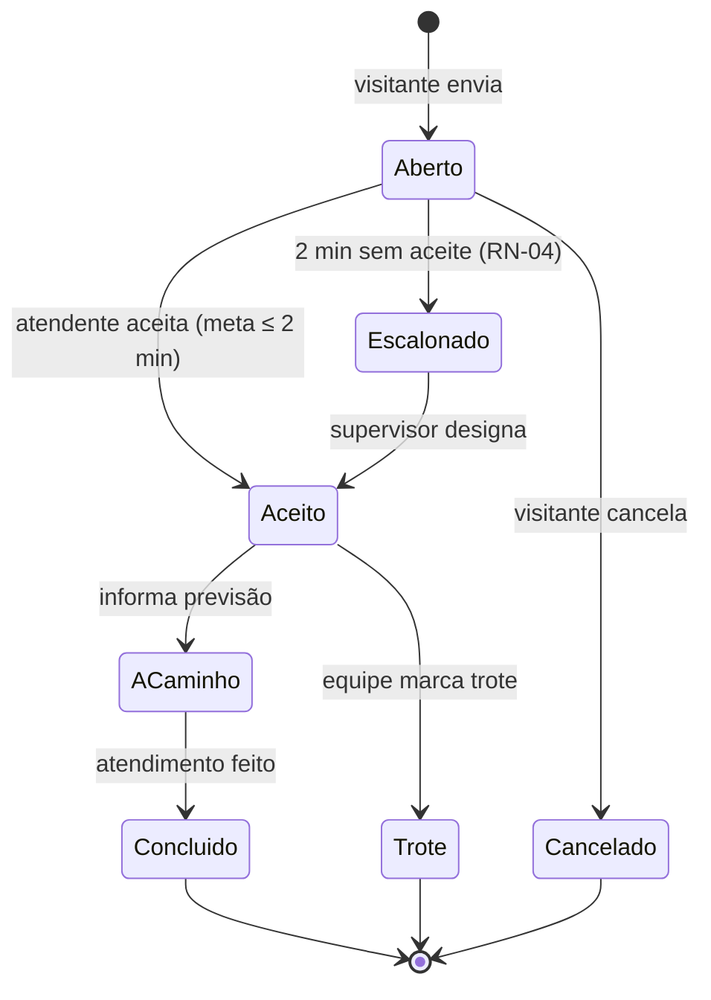

# 14. Operação no shopping

A tecnologia só funciona se o shopping **operar** a solução: placas bem posicionadas, equipe preparada e conteúdo atualizado.

## 14.1 Pontos de acesso (placas QR + NFC + Braille)

**Especificação da placa:**

| Elemento | Especificação |
|---|---|
| QR Code | Preto sobre branco, com margem livre (*quiet zone*), correção de erro nível Q, **lado mínimo de 10 cm** para leitura a cerca de 1 m (regra prática: distância ≈ 10 × lado) |
| NFC | Etiqueta NTAG213/215 com registro NDEF da URL `https://<domínio>/q/<CÓDIGO>`, no centro de um **símbolo tátil** (“encoste aqui”) |
| Texto | “Guia Dourado: acessibilidade e comunicação” + **código curto** (ex.: `MESA-07`) + domínio, em fonte grande e alto contraste |
| Braille e relevo | Código curto e “Guia Dourado” em Braille; moldura em relevo para localização pelo tato |
| Altura e posição | Faixa de alcance confortável para pessoa em cadeira de rodas e leitura tátil, **seguindo a ABNT NBR 9050**; perto do piso tátil quando houver |
| Segurança | Placa única (não adesivo solto), lacre, inspeção semanal contra QR falso colado por cima |
| Libras | Ícone de Libras + “Atendimento em Libras disponível” |

**Plano inicial de 20 pontos (piloto):**

| Local | Qtde. | Códigos |
|---|---|---|
| Entradas Av. JK, Av. NS-05 e Av. LO 2A | 3 | `ENT-JK`, `ENT-NS`, `ENT-LO` |
| Saídas dos elevadores (térreo e 2º pavimento) | 4 | `ELV-01-T`, `ELV-01-2`… |
| SAC / balcão de informações | 1 | `SAC` |
| Praças de eventos | 3 | `PE-CENTRAL`, `PE-CA`, `PE-RENNER` |
| Praça de alimentação (mesas reservadas e totens) | 5 | `MESA-01`… |
| Subsolos (perto dos elevadores e das vagas PNE/neurodiverso) | 2 | `S1-ELV`, `S2-ELV` |
| Sanitários PNE | 2 | `WC-T-1`, `WC-2-1` |

## 14.2 Fluxo de trabalho da Central

**Quem atende:** SAC (orientação, comunicação, acompanhamento), brigada (saúde), segurança (criança perdida, segurança). A Central direciona por tipo e mostra a **forma de comunicação** antes de a pessoa sair para o atendimento.

## 14.3 Roteiros de atendimento por forma de comunicação

| Forma | Como a equipe deve agir |
|---|---|
| **Libras** | Abrir T06 no celular do SAC (ou no da pessoa); usar texto em letras grandes; se for complexo, **chamar intérprete por vídeo**; olhar para a pessoa, não para o celular |
| **Texto** | Usar T06 em modo “digitar”; frases curtas |
| **Voz / pessoa cega** | Apresentar-se pelo nome e função; oferecer o braço (não puxar); descrever o caminho com referências; avisar ao sair |
| **Idioma (EN/ES)** | T06 com o idioma da pessoa; frases prontas |
| **Pictogramas / autismo** | Falar com calma, frases curtas, sem toque não solicitado; oferecer área tranquila; mostrar a prancha (T07) |
| **Cordão de girassol** | Perguntar “Como posso ajudar?” sem pedir explicação sobre a deficiência |

## 14.4 Treinamento da equipe (antes do piloto)

| Módulo | Carga | Conteúdo |
|---|---|---|
| Atendimento inclusivo | 2 h | Terminologia correta, deficiências ocultas, cordão de girassol, atendimento prioritário |
| Libras básica | 4 h | Saudações, números, direções, “aguarde”, “siga-me” (com instrutor surdo) |
| Uso da Central e do Guia Dourado | 1 h | Fluxo de pedidos, status de equipamentos, barreiras, modo conversa |
| Simulações | 1 h | Jornadas J1–J6 com pessoas com deficiência convidadas |

## 14.5 Governança de conteúdo

| Conteúdo | Responsável | Frequência |
|---|---|---|
| Lojas, horários, avisos | Marketing / operações | Semanal e sob demanda |
| Status de elevadores e escadas rolantes | Manutenção / segurança | **Em tempo real** |
| Barreiras reportadas | Operações | Triagem diária; meta de solução ≤ 7 dias |
| Linguagem simples e traduções | Conteúdo, com revisão humana | A cada alteração |
| Vídeos em Libras | Intérpretes parceiros | Trimestral |

## 14.6 Comunicação e lançamento

- Campanha **“Capim Dourado para Todos”** nas entradas, nas redes e nas mesas da praça de alimentação.
- Datas âncora: **Abril Azul** (autismo), **Setembro Verde** (inclusão da pessoa com deficiência, 21/09) e **Setembro Azul** (comunidade surda).
- **Hora silenciosa** mensal divulgada no app (T00 e T11).

## 14.7 Indicadores operacionais (painel da Central)

Pedidos por tipo e por forma de comunicação · tempo de aceite e de atendimento · pedidos escalonados · trotes · leituras por ponto QR/NFC · rotas concluídas (“cheguei”) · barreiras abertas e resolvidas · equipamentos fora de serviço (horas/mês).
